# E-commerce Sales & Customer Behavior Analysis | SQL Portfolio Project

**Author:** Ademola Melody  
**Tools:** MySQL, MySQL Workbench, SQL

## Project Overview
This project uses SQL to investigate e-commerce orders, sales, product performance, customer spending, payment methods, and refunds. It demonstrates database exploration, selected data validation, joins, aggregation, time-based analysis, and business-question-driven querying.

The analysis uses six tables: `customers`, `products`, `orders`, `order_items`, `payments`, and `refunds`.

## Business Questions
1. How many records are stored in each table?
2. Are selected values missing or are duplicate order IDs present in `orders`?
3. How many completed orders are there, and what is their item-line revenue?
4. How does completed-order revenue change by month?
5. Which products generate the most revenue and units sold?
6. Which customers have the highest spend and how many completed orders did they place?
7. Which dates have the highest order volume?
8. Which payment methods account for the most payment transactions and payment value?
9. How many refunds were recorded, and what is their total value?

## Database Tables

| Table | Purpose |
|---|---|
| `customers` | Customer identifiers, country codes, and customer segments |
| `products` | Product identifiers and product names |
| `orders` | Order identifiers, customer identifiers, dates, and statuses |
| `order_items` | Product IDs, order IDs, quantities, and line totals |
| `payments` | Payment IDs, order IDs, payment methods, and amounts |
| `refunds` | Refund IDs, order IDs, and refund amounts |

## SQL Skills Demonstrated
- Database exploration: `USE`, `SHOW TABLES`, `DESCRIBE`
- Data validation: row counts, selected null checks, duplicate checks
- Relational analysis: `JOIN`, `LEFT JOIN`
- Aggregation: `SUM`, `COUNT`, `COUNT(DISTINCT ...)`
- Grouping and filtering: `GROUP BY`, `HAVING`, `WHERE`
- Date analysis: `DATE`, `DATE_FORMAT`
- Subqueries, `UNION ALL`, sorting, and `LIMIT`

## Analysis Areas

### Data validation
The SQL script checks table sizes, selected missing values in `orders`, and duplicate `order_id` values. These are validation checks; they do not modify or clean the underlying data.

### Sales and monthly trends
Completed orders are joined to order items to calculate distinct completed orders and the sum of item-line totals. Monthly results should be grouped and sorted using a year-month value to preserve chronological order.

**Metric note:** `SUM(order_items.line_total)` is treated as item-line revenue. It should not be described as profit or revenue net of refunds unless those calculations are explicitly performed.

### Product performance
Order items are grouped by product to compare units sold and item-line revenue for completed orders. Results are sorted to identify the ten highest-revenue products.

### Customer spending
Completed-order item totals are aggregated by customer to identify high spenders and count their distinct completed orders.

### Order activity
Orders are counted by calendar date. This query includes all order statuses, so it describes order activity, not completed sales alone.

### Payments and refunds
Payment totals are grouped by payment method. Refund records and amounts are analysed separately. Do not combine these totals without validating the metric definitions and join logic.

## Screenshots

### Database structure and validation
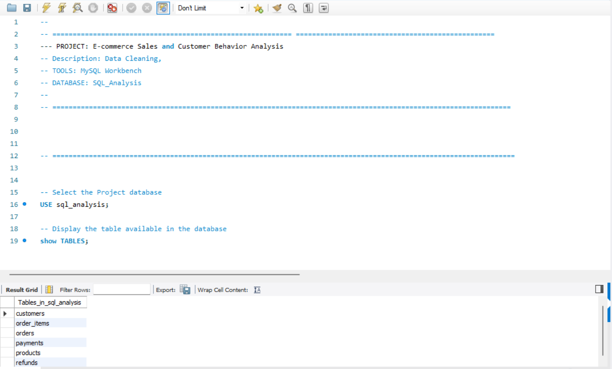

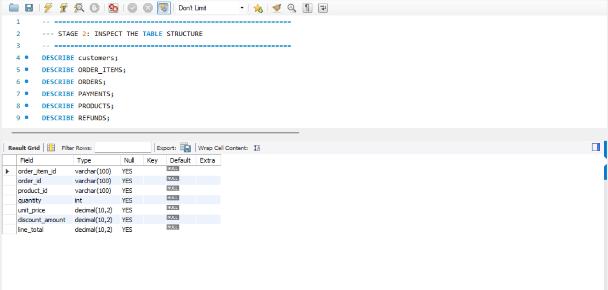

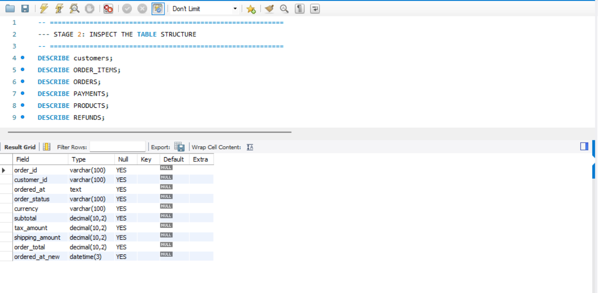

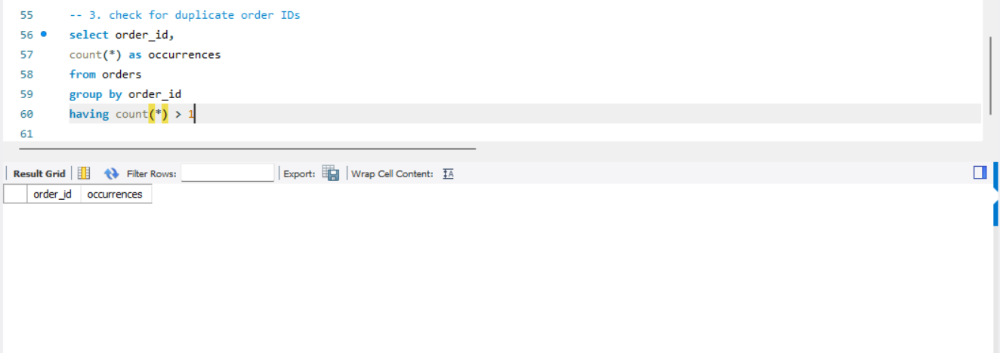

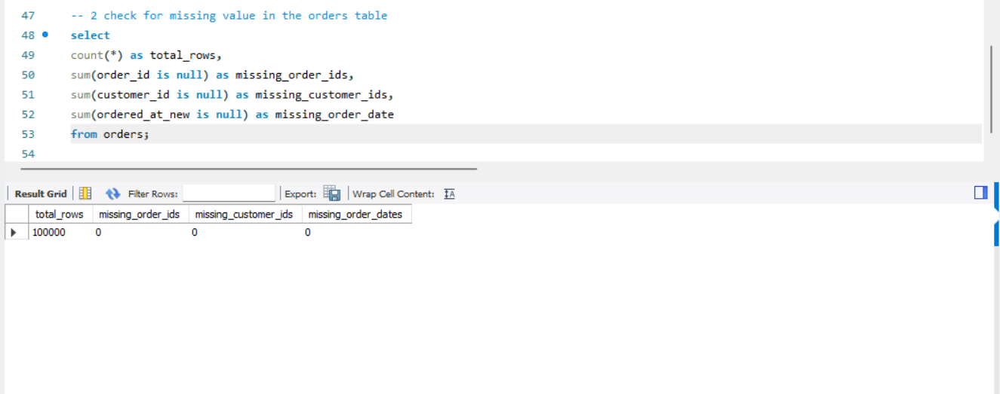

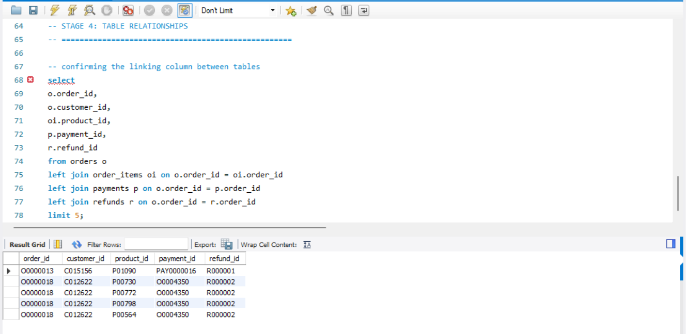

### Analysis results
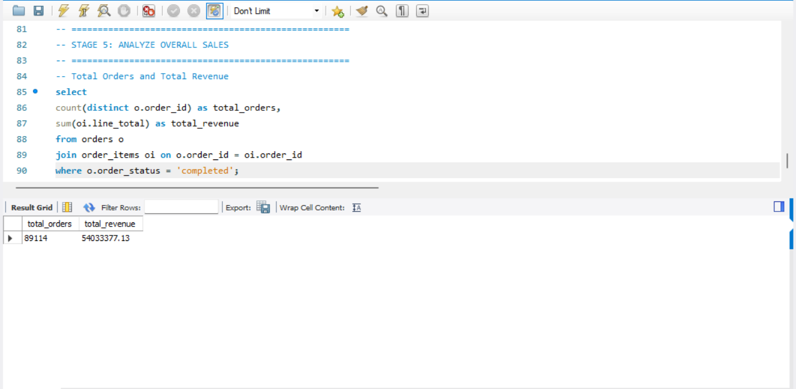

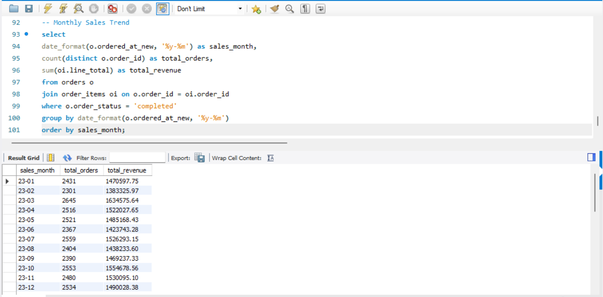

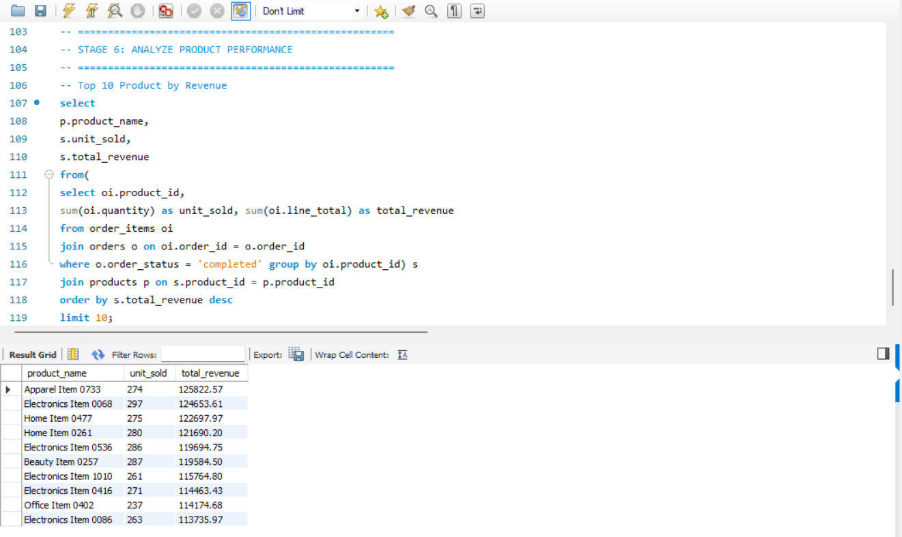

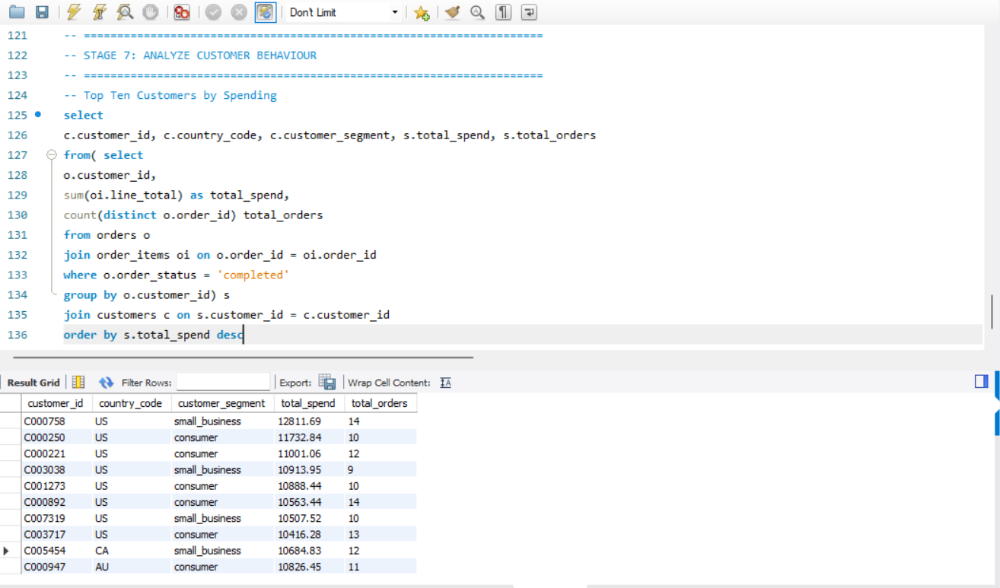

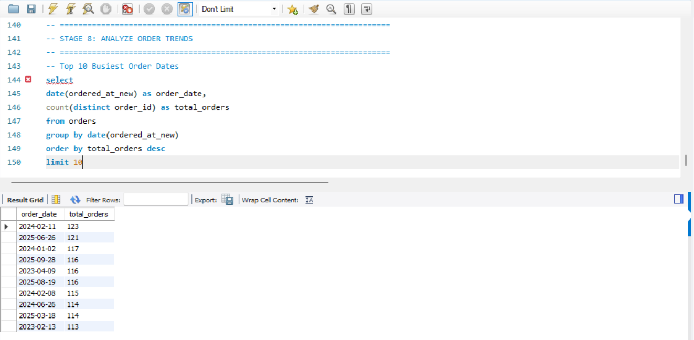

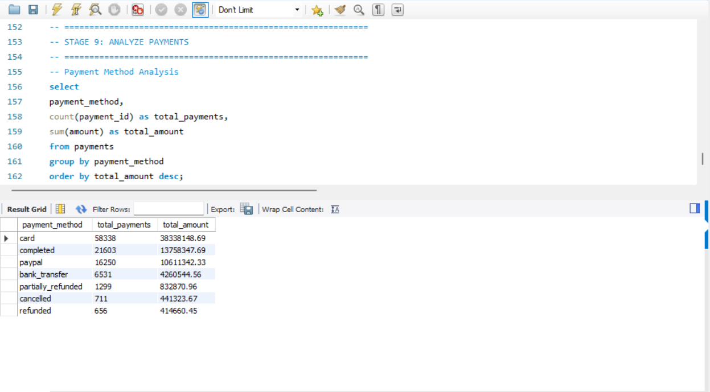

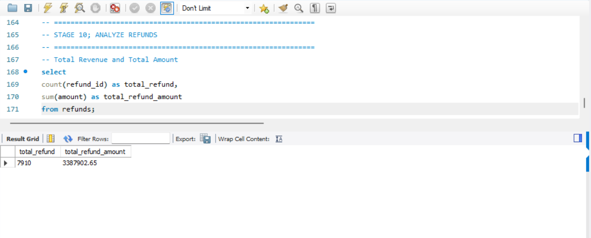

## Project Files
- [`Eccomerce_Sales_Analysis.sql`](./Eccomerce_Sales_Analysis.sql) — database exploration, validation, and analysis queries.
- PNG screenshots in the repository root — evidence of the queries and their outputs.

## How to Reproduce
1. Set up the project database in MySQL.
2. Load the six tables using the source dataset and matching column names.
3. Open the SQL script in MySQL Workbench.
4. Confirm the database name and column names match your setup.
5. Run the queries in order and review the results.
6. Compare the outputs with the screenshots.

> The dataset is not included in this repository, so another person will need access to the same source data to reproduce the results.

## Limitations and Interpretation
- The project checks selected missing values and duplicate order IDs; it does not claim to validate every column in every table.
- Sales revenue is based on `order_items.line_total` for completed orders. It is not automatically profit or net revenue after refunds.
- Payments and refunds are analysed separately.
- The busiest-date query includes all order statuses.
- Findings should be interpreted in the context of the dataset and metric definitions above.

## Conclusion
This project demonstrates how SQL can be used to explore relational data, validate selected data-quality conditions, combine related tables, and answer practical questions about e-commerce sales, products, customers, payment methods, and refunds.

---
**Author:** Ademola Melody
